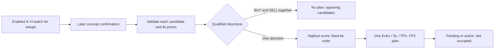

# How the A–H signals are selected

This describes the actual v0.8.0 source and the separate A–H display candidates. The frozen `pine/indicator.pine` / `pine/strategy.pine` default to **A only**. The currently tested Jakarta/session-label candidates default to **all A–H enabled**. Existing TradingView input overrides still determine which modules an applied instance runs.

## One confirmed concept can qualify

The enabled modules watch independently while the plan slot is free. Several setups can exist at once; eight strategies do **not** need to agree. Detection is only a setup. A later candle must meet that concept's confirmation, then its own complete proposed plan must pass the common checks. Trading decisions use closed chart candles.

The eight modules use nine candidate objects because E demand and E supply are independent. At most **one selected plan** is accepted by each script instance. Agreement does not add votes, extra score or positions.

| Situation on the same closed candle | Actual behavior |
| --- | --- |
| A is setting up; F is confirmed and passes checks | F can win immediately. The engine does not wait for A. |
| A BUY score100 and B BUY score90 both pass | Select A once. No second entry is added for B. |
| Equal scores and same direction | First in A, B, C, D, E demand, E supply, F, G, H order wins. |
| A qualified BUY and B qualified SELL | Reject the entire batch, regardless of score. A blocked/unqualified opposing setup does not cause this rejection. |
| One plan is selected while other setups exist | Reset competing candidate stages. Those old setups are not queued for later entry. |
| Another concept forms while a plan is pending/active | No additional plan is accepted. Existing candidates can still expire or invalidate; there is no pyramiding or automatic reversal. |
| The slot becomes free | New detection/confirmation is still subject to cooldown, session quota and all other gates. |

## Concept-specific confirmation stages

These counts describe the main **stages**, not the number of individual Boolean predicates. Prerequisites and the shared checks below also apply. SELL mirrors the described BUY conditions.

| Module | Main stages | What must happen before the shared checks |
| --- | ---: | --- |
| A — Sweep / MSS / FVG | 3 | Sweep a previously confirmed swing low and reclaim it → on a later candle, bullish displaced close above the frozen opposite swing **with an FVG** → on a still later candle, intersect the FVG and close bullish above its upper boundary. |
| B — CRT | 2 | Sweep/reclaim the previous completed reference candle's range → later bullish close above the sweep candle's high. Reference is M15 by default and cannot be below the chart timeframe. |
| C — Pivot Turtle Soup variant | 2 | False breakout/reclaim of an eligible confirmed pivot, old enough since confirmation → later bullish close above the sweep candle's high. This is the project's pivot variant, not the original multi-day Turtle Soup definition. |
| D — K-SNR | 2 | First require at least two confirmed same-side pivots near the level. Then a displaced breakout followed by a later directional retest, **or** rejection/failed breakout followed by a later close beyond the rejection candle. K-SNR is the display name for these existing rules. |
| E — Supply/demand | 2 | Opposite candle followed by displacement through a known confirmed swing creates a frozen zone → later zone intersection and directional close beyond its near boundary. Far-edge breach invalidates; too many tested bars expire it. |
| F — Structural trend pullback | 2 | Chart structure and EMA ordering establish direction; a valid EMA9/21 pullback freezes its trigger → later directional close through the pullback candle's extreme, with the trend still valid. EMA50 ordering is required when its input is enabled. |
| G — AMD range approximation | 2 | Prior compressed range plus sweep/reclaim → later displaced directional close beyond the **opposite** frozen range boundary. The prior range and detection cooldown are also required. |
| H — Confirmed Quasimodo approximation | 2 after prerequisites | Five alternating confirmed pivots and a recorded closing neckline break in the required order establish the pattern → a later directional retest of the first-shoulder band confirms. No entry is backdated to a pivot candle. |

Frozen invalidation levels, setup expiry and one-use pivot/reference rules remain mandatory. A visible OB, FVG, swing, BOS or session line alone does **not** trigger a trade. The confirmation board shows SETUP, blocked checks, and selected active/pending plans separately.

## Shared checks, Entry and targets

`candidateRejection()` contains **17 Boolean checks plus one quality threshold**. Some are conditional on their inputs: date window, allowed direction, structural invalidation, available targets, Fibonacci filter, premium/discount filter, volatility, manual pause, session, H1 alignment, EMA alignment, stop distance, entry distance, TP2 reward/risk, valid price ordering, session quota and cooldown; then minimum quality. The module must also be enabled/ready and the plan slot free. A Strategy can additionally reject an invalid or too-small simulation quantity.

Current captured configuration uses London session, H1 alignment, quality≥75, cooldown5 bars and maximum5 plans per selected session. Optional EMA/Fibonacci/premium-discount filters are off. Every qualifying concept must pass the enabled shared checks; confirmation alone does not bypass them. Quality100 means the heuristic categories scored100, **not** a100% winning probability.

- **Close entry:** confirmation close. **Limit:** frozen zone midpoint. **Breakout:** one tick beyond the confirmation candle. Pending entry is not a fill.
- **Structural SL:** the selected concept's invalidation, plus the outward ATR buffer. Alternative Swing/ATR/OB/Sweep-extreme modes have their own availability checks. There is no rule that every concept uses an FVG as its stop.
- **Fixed-R TP:** planned risk times R1/R2/R3, default1R/2R/3R. Structure needs three distinct valid opposing levels; Hybrid can fall back to the complete fixed-R set. All prices are tick-rounded and must be ordered on the correct side.
- The Indicator models execution; Strategy fills come from the emulator. Market orders with `process_orders_on_close=false` normally fill on the next available tick, often the next bar open. [TradingView order processing](https://www.tradingview.com/pine-script-docs/concepts/strategies/#order-creation-and-execution).

## Why M15 can show BUY while M5 shows SELL

Supported standard-candle chart periods are **M1, M3, M5 and M15**, not just M5. Each chart independently calculates its own swings, ATR, ranges, EMA pullbacks, candidates, cooldown, quota and simulated position. Three M5 candles form one M15 candle, so the two histories can produce different setups. A previous plan retained on the chart is also different from a new signal now.

Timeframe changes alter bar-based periods: swing strength3 requires15 minutes of right-hand bars on M5 versus45 on M15; cooldown5 means25 versus75 minutes; expiry20 means100 versus300 minutes. Those differences do not change the configured15-minute holding-time input, whose evaluation still depends on script calculation/fill timing.

**Important qualification:** with identical feed, inputs and H1-alignment filter enabled, two *fresh, opposite* plans at the same decision time should not both pass the same completed-H1 direction check. To investigate that case compare embedded plan timestamps, actual runtime settings and exact compiled source, including whether one display says PREVIOUS/CLOSED. M15 structure is displayed context; it is not automatically an M15-consensus entry requirement for the M5 chart. No higher-timeframe agreement rule has been added in this UI update.

## New chart annotations

The separate session-label candidates retain the Jakarta ladder and add:

- Dotted vertical **OPEN/CLOSE** lines and small time labels for Asia/Tokyo09:00–18:00, London08:00–17:00 and New York08:00–17:00, each measured in that city's local timezone. These are this project's existing session definitions, not an exchange schedule for spot gold.
- Labels show **WIB / UTC+7**. Tokyo is07:00–16:00 WIB; London is15:00–00:00 WIB in winter or14:00–23:00 in summer; New York is20:00–05:00 WIB in winter or19:00–04:00 in summer. London and New York switch independently around their DST transition weeks. [TradingView IANA timezone behavior](https://www.tradingview.com/pine-script-docs/concepts/time/#time-zones).
- A boundary is drawn only when the relevant actual boundary candle closes. Missing market data does not create a fabricated boundary at the next available candle. The last inside candle supplies the session close, including Friday's last available boundary candle. Lines/names are visual context and do not turn off the London-only trading filter. [Session/time API behavior](https://www.tradingview.com/pine-script-docs/concepts/sessions/#using-time-based-sessions).
- A tiny label such as **B CRT · SELL plan confirmed** on the selected confirmation candle, with timeframe, WIB confirmation time and a tooltip containing reason/Entry/SL/TPs. Pending plans say pending; a model fill is a separate event. The Entry callout also names the module. Unselected or unsafe candidates do not get a signal label.
- Boundary history is bounded to18 marks by default; selected-concept labels to8. Both are adjustable, and Asia/London/New York/end markers can be toggled separately. These8 new display controls do not change any trading predicate.

The subsequent **Clear decisions** candidate changes historical concept captions to **plan recorded**, fades closed prices and adds **NO ACTIVE ENTRY** plus a setup watch. A trigger already checked on the last closed bar shows its blocking reason instead of requesting the same trigger again. The watch reads existing candidate state; it does not emit an earlier entry or bypass the session/risk checks. [Native verification](reports/native-v080/signal-clarity-2026-11-07/README.md).

The preceding genuine combined Indicator capture contains78 accepted plans: B46, C9, D3, E5, F13, H2, A0 and G0. This is evidence that six modules were selected in that particular combined run, not proof that all modules always produce entries or are profitable. A-only research separately produced two positions; competing plans change which setups the combined run can observe/select. Do not loosen confirmation rules to force every module to appear.
