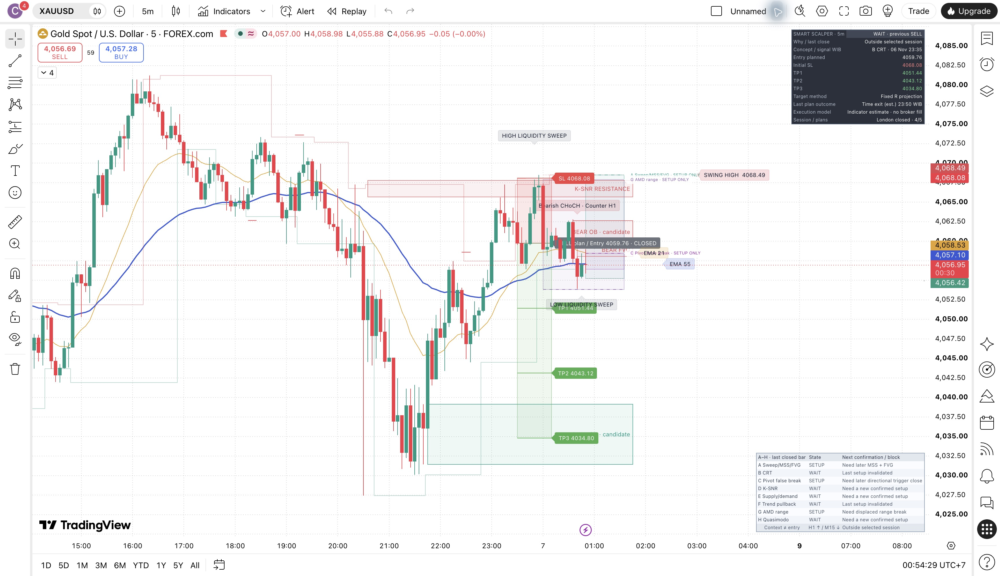

# Jakarta signal ladder — completed November 7, 2026

The requested Indicator display is applied to the existing FOREXCOM:XAUUSD M5 chart and survived a native browser reload. The timezone menu visibly checks **(UTC+7) Jakarta**, the price/outcome card uses **WIB**, and the final chart has smaller gray Entry, red SL and green TP1–TP3 callouts with red/green risk/reward shading. Existing FVG, OB, swings, structure, K-SNR and A–H setup context remain. Completed plans say **CLOSED** and their actual estimated outcome remains in the card; green target labels do not mean those targets were reached. The minimum eight-bar drawing width is for readability, not holding duration.

This is a separate display candidate, not a baseline trading-rule release. [Indicator source](../../../pine/experiments/indicator_jakarta_ladder.pine) SHA-256 `2e2495d846d4e2f49f13c649e59aef45f203079786e358aa951ce31bb02a4e5f` has a full native editor copy-back matching exactly, followed by visible **Compiled. / Added to chart. at 9:41:54 PM** on November 6. The [source-attribution record](indicator-source-attribution.json) explains the actual copy-back method. The pending compile snapshot is preserved separately from the successful one.

The matching [Strategy display candidate](../../../pine/experiments/strategy_jakarta_ladder.pine), SHA-256 `4d3a4772e56fbbbbb91afeb8675ec66a43ba7eccdadc98dd6e6774b6f2ad9801`, was generated and locally parsed. This revision has **not** been compiled or backtested natively. The existing applied exit-audit Strategy was preserved hidden.

| Check | Actual result |
| --- | --- |
| Non-display source preservation | Generator reconstructs each frozen stable-display parent byte-for-byte after reverting only title and the two presentation regions. No entry, confirmation, order, sizing, stop, target, session, alert payload or UNIX timestamp calculation changed. |
| Runtime inputs | All 117 native Indicator controls captured; all match the prior saved Indicator configuration. A–H enabled, audit logging on, London session with `Europe/London`, research date restriction off, Close entry, 15-minute time exit. Jakarta changes display time only. |
| Native display regression | Download has **78 plans / 338 messages**. All **76** plans and **330** messages in the prior genuine reference are retained unchanged at tolerance zero. Two additional B plans are dated November 6 **22:30 and 23:35 WIB**. |
| Reload stability | Before/after raw CSVs are **byte-identical**: all **78 plans / 338 messages**, SHA-256 `6cae46557a6ff0350f5656d9d3453da9e4ed94c9f4736f56c7abcdb0131f8e55`. This is one reload observation, not candle-by-candle Replay or cross-model parity. |
| Shared price scale | After reload the native menu says **Pinned to right scale**, with new-left/new-right as separate alternatives. Rendered Entry/SL/TP prices align with the candle axis; no independent overlay scale was observed. |
| Local verification | Full implementation run: TypeScript, **203 tests / 25 files**, baseline generation consistency and **25 independent Pine parses** passed. The presentation-only generator guard and evidence analysis were also rerun successfully at completion; no unrelated tests were added. |
| Chart persistence | New Indicator remains visible after reload. All three preceding studies are preserved hidden. Editor/Logs and menus closed, legend collapsed, **All changes saved**, **Autosave ON**, and Jakarta selection verified. |
| Free-plan limitation | Saving an additional library script was blocked by the actual **1 saved script** upgrade dialog. No upgrade or deletion/replacement of the existing library script occurred. The applied chart instance persisted across the tested reload; the complete new source is also saved locally. |



[Machine-readable analysis](display-verification.json), [before-reload CSV](indicator-before-save-raw.csv), [after-reload CSV](indicator-after-reload-raw.csv), [Jakarta checkmark](after-reload-jakarta-selected.png), [Autosave evidence](final-autosave.png), and [artifact hashes](verification-receipt.json) preserve the actual results.

Reproduce the comparison without rewriting raw files:

```sh
python3 reports/native-v080/jakarta-ladder-2026-11-06/analyze-display.py
python3 scripts/generate_jakarta_ladder.py --check
```

Frozen `pine/indicator.pine` remains `c7558b9f8e4ab590167dc60eef9028bc0baded806e1d796ff987b141c66314b4`; `pine/strategy.pine` remains `42b4e1683397741de60ac1573effb4e18bde737b166d6d143d1373191ea3f5c0`. Project remains **v0.8.0**, production stays database-free, and no live alert, Telegram message, deployment or real trade was made. Existing full-stream Indicator/Strategy differences, the earlier unresolved recalculation observation, broader Replay and OOS requirements remain open. This UI update establishes neither faster qualifying signals nor profitability.
