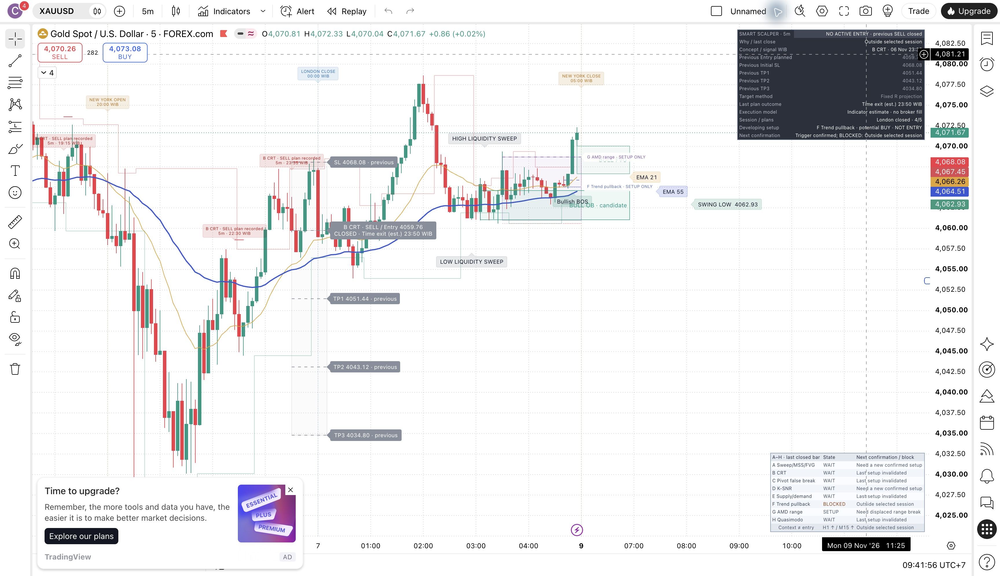

# Clear decisions revision — November 7, 2026

The separate **A–H Clear decisions Indicator** was compiled, applied, saved and reloaded on the existing FOREXCOM:XAUUSD M5 chart. This revision addresses the misleading appearance of an old closed ladder and makes the next setup/block explicit. It does **not** make confirmed entries earlier, remove stop losses, improve measured performance, or complete the v0.9.0 release gates.

## The pictured SELL was already closed

The genuine Indicator stream identifies B CRT at **November 6, 23:35 WIB**, Entry **4059.76**, SL **4068.08**, TP1–TP3 **4051.44 / 4043.12 / 4034.80**. Its `TRADE_CLOSED` payload records `closeReason: TIME_EXIT` at **23:50 WIB**. There is no `STOP_LOSS_HIT` or target event for this plan in the supplied full stream. The historical log prefix is 23:45; the embedded closing timestamp is 23:50. Later price crossing the retained SL line does not turn this already-ended estimate into a later stop event.

This identifies the **Indicator model's** outcome, not an actual broker exit or realized P&L. The raw records and setup-to-plan latency analysis are in [pictured-plan-and-timing.json](pictured-plan-and-timing.json).

The complete captured sample has **78 estimated closed plans: 69 time exits and 9 stops**. Stop events are B CRT 6, E supply 2 and H Quasimodo 1. Time exits are not automatically wins; these records lack actual exit price/P&L. These counts cannot estimate a profitable live win rate.

## What changed

- The card explicitly says **NO ACTIVE ENTRY · previous SELL closed** when the retained ladder is historical.
- Closed Entry/SL/TP labels are gray, their lines dashed, and their boxes faded. The Entry label includes the recorded terminal reason/time. Active plans retain gray Entry, red SL and green TP1–TP3. `Closed plan prices` offers Faded or Hide.
- The setup watch reads the already-existing frozen concept state. It reports the pending confirmation condition/price or the check that blocked a confirmed trigger. Native inspection caught and corrected an intermediate message that incorrectly requested a fresh trigger when F had already triggered but was blocked by session hours. The final native chart says **Trigger confirmed; BLOCKED: Outside selected session** and **potential BUY · NOT ENTRY**.
- Historical selected-concept labels say **plan recorded**, retaining the module, direction, timeframe, WIB close time and tooltip prices. FVG, OB, swings, structure, K-SNR, bounded A–H setup guides and session OPEN/CLOSE annotations remain.
- Both candidate generators reconstruct their frozen parents byte-for-byte after reverting only the documented display replacements. No candidate detection, confirmation, arbitration, order, sizing, SL/TP, session filter, cooldown, quota, alert or timestamp calculation was modified.

See [SIGNAL_FLOW.md](../../../SIGNAL_FLOW.md) for the exact A–H stages, shared gates and timeframe differences. One enabled concept can qualify; all eight do not need to agree. Several setups can coexist, but only one selected plan is accepted per instance.

## Actual verification

| Check | Result and scope |
| --- | --- |
| Native Indicator source | Full 1,685-line editor copy-back normalizes exactly to `d4d4866086e13d95fb0e5162bee51050a6fe47a010f4be004bdc5d5c28aba69e`. Raw CRLF copy preserved. |
| Native compilation | Requested 09:33:18 WIB; **Compiled. / Updated on chart. 09:33:54 WIB**, November 7. [Native compiler AX](indicator-compile-success.ax.txt), [screenshot](indicator-compile-success.png), [attribution](source-attribution.json). Earlier09:27 source/compile preserved separately in `initial-clarity-attempt/`; that revision is superseded. |
| Actual runtime inputs | All **127** inputs observed across four native dialog captures. All 117 shared controls match the preceding Jakarta instance; the 8 session/label controls and 2 new clarity controls were also captured. A–H enabled, H1 alignment on, London session filter on, Close entry, 15-minute hold, research date restriction off, audit logging on. [Observed values](indicator-runtime-inputs.json). |
| Native display regression | Before/after CSVs contain **78 plans / 338 messages**, with every ordered message byte-identical. Planned timestamps, levels and lifecycle payloads match at tolerance 0. |
| Saved-chart reload | The freshly downloaded reload CSV has the same SHA-256 and all 78 plans / 338 messages unchanged. This is a **same-model historical reload** observation, not Indicator/Strategy parity, live non-repainting proof or Bar Replay. [Comparison](reload-regression.json). |
| Scale and persistence | Applied title/study set persisted; three preceding studies remained hidden. The post-reload native menu reports `Pin to scale (now right)` and the rendered levels align with the candle scale; no separate visible overlay scale was observed. |
| Autosave | Restored **ON**, independently visible in [autosave-on-verified.png](autosave-on-verified.png). `All changes saved` was observed after the chart save/reload. |
| Local regression | `npm run verify` passed TypeScript, **203 tests / 25 files**, baseline generation consistency and **29 independent Pine parses**. [Actual output](local-full-verification.txt). Separate clarity generator reconstruction/check also passed. |
| Strategy sibling | Generated `strategy_signal_clarity.pine`, SHA-256 `8461833b9f466380dd03d877e94215165544dfee038e407e6d130c840abac479`; locally parsed only. No native compile/backtest is claimed for this revision. Existing chart Strategy preserved. |

The raw exports cover log prefixes October12–November6; they are not a declared full chart-history/OOS window. All three CSV hashes equal `6cae46557a6ff0350f5656d9d3453da9e4ed94c9f4736f56c7abcdb0131f8e55`.



The image above is an unmodified09:41:56 native screenshot. Its original filename is retained; it shows chart rendering, **not** the Autosave menu. `autosave-on-verified.png` is the actual09:59 menu evidence. `autosave-on-final.png` is a later chart-only capture despite its filename.

## Limits and next experiments

The accepted-plan sample shows a B CRT median setup-to-plan delay of 7.5 minutes, F 10 minutes and H 35 minutes on M5. This excludes rejected setups and the time before a setup was recognized. It does not justify relaxing a confirmation rule or identify the most profitable module.

Earlier awareness now comes from the **setup watch**, while confirmed entries still wait for a closed candle and every enabled gate. On the inspected last bar, London was closed and F was blocked by that actual setting. The session annotations do not enable trading outside London. Pine's confirmed-bar behavior is documented in [TradingView bar states](https://www.tradingview.com/pine-script-docs/concepts/bar-states/); [repainting guidance](https://www.tradingview.com/pine-script-docs/concepts/repainting/) explains why one historical reload cannot settle live timing.

For a speed experiment, freeze one candidate configuration and compare M3 against M5 with identical cost assumptions and chronological held-out periods. Evaluate each module independently before combining it. Keep confirmation-close entries and report trade count, adverse excursion, costs, drawdown and actual net outcome. Do not widen a stop after an observed loss or select a threshold from this same sample and call it OOS.

Chrome disconnected with `noWindowsAvailable` during the final optional input recapture/legend cleanup. The 127 inputs were captured **before** reload; a complete second 127-control capture was not completed. The earlier chart save/reload, downloaded reload CSV, retained studies, scale menu and Autosave-on observation succeeded. Final cosmetic cleanup is not claimed. Capture attempts/empty interrupted read are preserved under `capture-attempts/` and are excluded from comparisons. Direct Downloads reads temporarily stalled; the successful byte-preserving copy is `indicator-reload-download-verified.csv`.

Live candle-by-candle Replay, existing cross-model mismatches, current-source OOS, profitability and live Telegram delivery remain unverified. No alert was created, no Telegram message sent, no deployment made and no real trade placed. Production remains database-free and project version remains **0.8.0**. Frozen baseline Indicator/Strategy hashes are unchanged.

Reproduce locally:

```sh
python3 scripts/generate_session_labels.py --check
python3 scripts/generate_signal_clarity.py --check
python3 reports/native-v080/signal-clarity-2026-11-07/analyze-capture.py
```

[Machine-readable capture analysis](capture-analysis.json) and [artifact hashes](artifact-hashes.json) record the bounded results.
